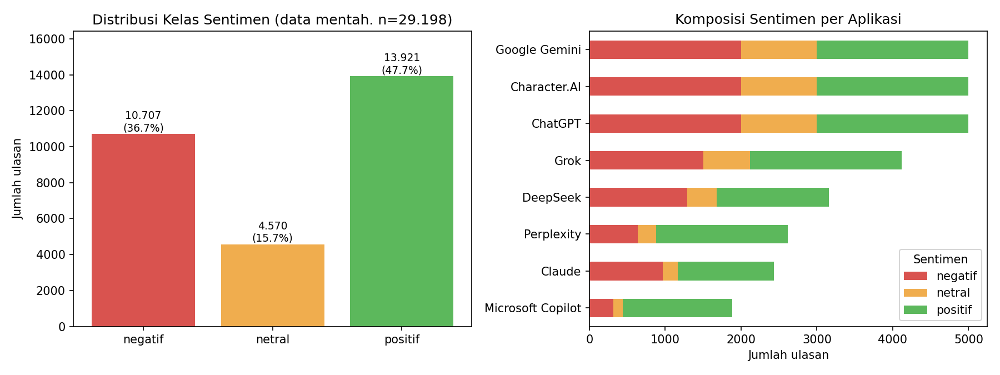
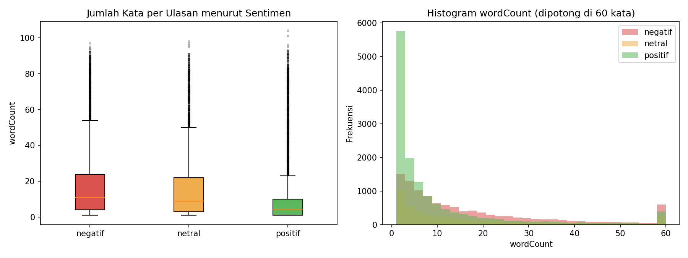
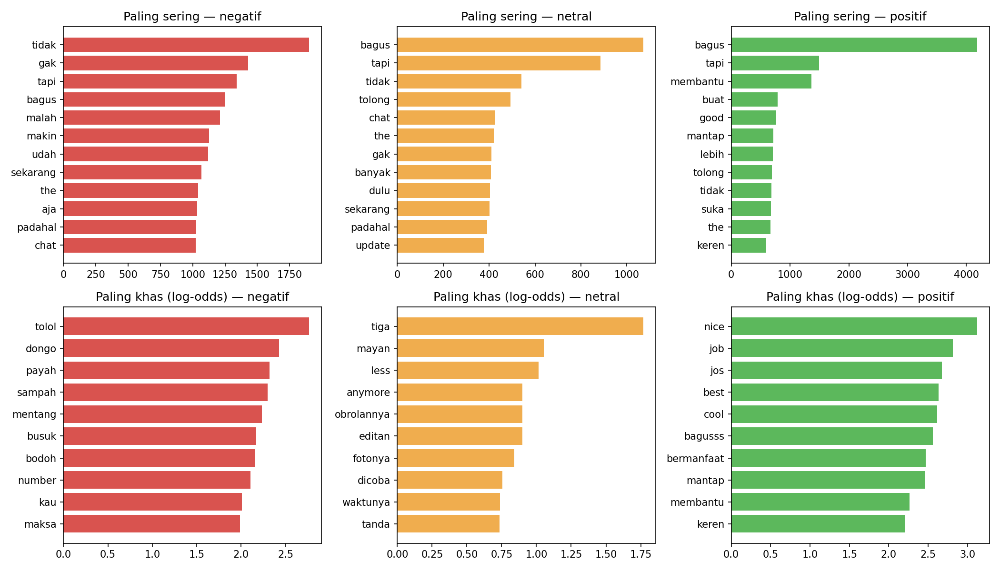

## INFORMASI PROYEK
**Judul Proyek:**  
Klasifikasi Sentimen Pengguna terhadap Aplikasi AI Chatbot di Indonesia Menggunakan Pendekatan Deep Learning
 
**Nama Mahasiswa:**  
1. Iqbal Abdullah  
2. Rindy Cantika Agustina Putri  
**NIM:**  
1. 244311044  
2. 244311057  
- **Program Studi:** Teknologi Rekayasa Perangkat Lunak
- **Mata Kuliah:** Data Science
- **Dosen Pengampu:** Gus Nanang Syaifuddin, S.Kom., M.Kom.  
- **Tahun Akademik:** 2026/5 
- **Link GitHub Repository:** https://github.com/Adzer2605/chatbot-sentiment-classification.git
- **Link Video Pembahasan:** [URL Video (YouTube/Drive)]  
- **SDG yang Dipilih:** SDG 9 – Industri, Inovasi, dan Infrastruktur  
- **Target SDG yang Relevan:** Target 9.5 – Meningkatkan penelitian ilmiah dan kemampuan teknologi sektor industri
## 0. KERANGKA ML LIFECYCLE (L-M-O-P)
 
Laporan ini disusun mengikuti **ML Lifecycle** yang terdiri dari empat tahap berulang (iteratif):
 
| Tahap                  | Singkatan | Inti Pertanyaan                                                               | Bagian Laporan        |
| ---------------------- | --------- | ----------------------------------------------------------------------------- | --------------------- |
| **Learning Problem**   | **L**     | Apa target, objective, dan datanya?                                           | Bab 2, 3, 4, 5        |
| **Model Design**       | **M**     | Model family/arsitektur apa, hypothesis space, dan inductive bias/asumsi apa? | Bab 6 (6.x.1 – 6.x.3) |
| **Optimization**       | **O**     | Bagaimana model dilatih: loss, optimizer, tuning, regularisasi, konvergensi?  | Bab 6 (6.x.4 – 6.x.6) |
| **Predict & Evaluate** | **P**     | Seberapa baik prediksi model berdasarkan metrik evaluasi?                     | Bab 7                 |
 
```
   L (Learning Problem) ──► M (Model Design) ──► O (Optimization) ──► P (Predict & Evaluate)
          ▲                                                                   │
          └─────────────── iterasi / perbaikan berdasarkan hasil evaluasi ────┘
```
 
**Catatan untuk mahasiswa:** Setiap bagian diberi label **[L]**, **[M]**, **[O]**, atau **[P]**. Pastikan Anda dapat menjelaskan keterkaitan antar tahap, misalnya bagaimana hasil **P** mendorong perbaikan pada **L/M/O** (Bab 7.5).
 
---
 
## 1. LEARNING OUTCOMES
 
Pada proyek ini, mahasiswa diharapkan dapat:
 
1. **[L]** Mengidentifikasi masalah nyata dari **ide sendiri** yang selaras dengan salah satu tujuan **SDGs** ([Agenda 2030 – sdgs.un.org/2030agenda](https://sdgs.un.org/2030agenda)), lalu merumuskan problem statement (target, objective, data) secara jelas
2. **[L]** Melakukan analisis dan eksplorasi data (EDA) secara komprehensif (**OPSIONAL**)
3. **[L]** Melakukan data preparation yang sesuai dengan karakteristik dataset
4. **[M]** Merancang tiga model machine learning dengan justifikasi hypothesis space dan inductive bias (**WAJIB**):
   - Model baseline
   - Model machine learning / advanced
   - Model deep learning (**WAJIB**)
5. **[O]** Mengoptimasi model secara sistematis (loss function, optimizer, hyperparameter tuning, regularisasi)
6. **[P]** Menggunakan metrik evaluasi yang relevan dengan jenis tugas ML dan menganalisis hasilnya
7. Melaporkan hasil eksperimen secara ilmiah dan sistematis
8. Mengunggah seluruh kode proyek ke GitHub (**WAJIB**)
9. Menerapkan prinsip software engineering dalam pengembangan proyek
---
 
## 2. PROJECT OVERVIEW **[L]**
 
### 2.1 Latar Belakang
 
Pesatnya perkembangan teknologi Kecerdasan Buatan (Artificial Intelligence/AI), khususnya dalam domain Natural Language Processing (NLP), telah memicu adopsi secara masif aplikasi AI Chatbot di Indonesia (seperti ChatGPT, Claude, dan Gemini). Meskipun adopsinya tinggi, umpan balik dari pengguna di platform digital seperti Google Play Store sering kali tersebar heterogen dan tidak terstruktur. Pengguna menyampaikan beragam reaksi, mulai dari kepuasan terhadap responsivitas aplikasi hingga keluhan terkait "halusinasi" AI, keterbatasan pemahaman bahasa gaul Indonesia, atau kendala infrastruktur aplikasi (seperti lag atau error).
 
Untuk memahami persepsi masyarakat secara komprehensif, dibutuhkan sistem otomatisasi yang mampu mengklasifikasikan sentimen pengguna. Proyek ini penting karena mengevaluasi langsung kualitas infrastruktur perangkat lunak AI yang digunakan publik. Dengan membangun pemodelan analisis sentimen berbasis teks ulasan, pengembang aplikasi dapat memperoleh wawasan data-driven mengenai kelemahan produk mereka di pasar lokal.
 
 
**Referensi:**
 
> Minaee, S., Kalchbrenner, N., Cambria, E., Nikzad, N., Chenaghlu, M., & Gao, J. (2021). Deep Learning--based Text Classification: A Comprehensive Review. *ACM Computing Surveys (CSUR)*, 54(3), 1-40.
> Goodfellow, I., Bengio, Y., & Courville, A. (2016). *Deep Learning*. MIT Press.
> Chen, T., & Guestrin, C. (2016). XGBoost: A Scalable Tree Boosting System. *Proceedings of the 22nd ACM SIGKDD International Conference on Knowledge Discovery and Data Mining*, 785–794.
 
### 2.2 Keterkaitan dengan SDGs (WAJIB)
 
| Komponen | Pertanyaan Panduan | Jawaban Anda |
| --- | --- | --- |
| **SDG yang dipilih** | Goal nomor berapa dan apa namanya? | SDG 9 – Industri, Inovasi, dan Infrastruktur |
| **Target SDG** | Target (misal 3.4, 13.1) mana yang paling relevan? | Target 9.5 – Meningkatkan penelitian ilmiah dan kemampuan teknologi sektor industri (khususnya pengembangan infrastruktur NLP dan aplikasi AI). |
| **Masalah nyata** | Masalah konkret apa yang diangkat? Siapa yang terdampak? | Umpan balik pengguna Indonesia terhadap aplikasi AI Chatbot (seperti ChatGPT dan Google Gemini) tersebar dalam puluhan ribu ulasan tidak terstruktur. Pengembang kesulitan memetakan keluhan spesifik seperti halusinasi jawaban, keterbatasan pemahaman bahasa gaul Indonesia, dan kendala teknis. Pihak terdampak: pengguna akhir (pelajar, pekerja, masyarakat umum) dan pengembang aplikasi AI. |
| **Peran ML** | Mengapa ML/DL cocok? Apa keputusan atau proses yang dibantu? | Klasifikasi sentimen teks berbahasa Indonesia dengan ML/DL mengotomatiskan pelabelan puluhan ribu ulasan menjadi positif, netral, dan negatif. Proses yang dibantu adalah evaluasi kualitas layanan dan penentuan prioritas perbaikan fitur/infrastruktur aplikasi AI. |
| **Indikator kontribusi** | Bagaimana hasil model berkontribusi pada target SDG (langsung/tidak langsung)? | Tidak langsung: performa model klasifikasi sentimen (Accuracy dan F1-Score) serta analisis kesalahan pada *confusion matrix* menghasilkan pemetaan kelemahan AI di mata pengguna Indonesia yang dapat dijadikan masukan evaluasi pengembangan teknologi lokal. |
| **Pertimbangan etika** | Risiko bias, privasi, atau dampak salah prediksi? | Privasi: ulasan bersifat publik tetapi memuat `userName`, sehingga kolom identitas pengguna tidak digunakan dalam pemodelan dan analisis dilakukan secara agregat. Bias: ulasan Google Play Store cenderung didominasi pengguna dengan pengalaman ekstrem (sangat puas atau sangat kecewa) serta mengandung sarkasme dan bahasa gaul yang berisiko memicu bias klasifikasi. Dampak salah prediksi: keluhan negatif yang terprediksi positif dapat membuat bug atau kelemahan kritis AI terabaikan, sehingga metrik F1-Score dan analisis *confusion matrix* dipantau ketat. |
 
**Sumber ide:** Pengamatan langsung terhadap tingginya adopsi aplikasi AI Chatbot di kalangan mahasiswa dan masyarakat Indonesia, serta banyaknya keluhan mengenai akurasi jawaban dan pemahaman bahasa Indonesia pada kolom ulasan Google Play Store.
 
### 2.3 Ringkasan Alur Lifecycle Proyek
 
Pada tahap **L**, masalah dirumuskan sebagai klasifikasi teks multikelas (positif, netral, negatif) menggunakan dataset `indonesian_ai_chatbots_reviews.csv` (29.198 ulasan periode Juni 2023 – November 2026), dilanjutkan pembersihan teks, normalisasi bahasa tidak baku, ekstraksi fitur TF-IDF / tokenisasi, dan *stratified splitting* tanpa *data leakage*. Pada tahap **M**, dirancang tiga model: Linear SVM sebagai baseline, XGBoost sebagai model advanced, serta Bidirectional LSTM (Bi-LSTM) dengan *Word Embedding* sebagai model deep learning. Pada tahap **O**, dilakukan *hyperparameter tuning* untuk model ML serta optimasi *learning rate*, *batch size*, *dropout*, dan pelatihan minimal 10 *epoch* untuk Bi-LSTM. Pada tahap **P**, ketiga model dievaluasi pada *test set* menggunakan Accuracy, F1-Score, dan Confusion Matrix, lalu hasil *error analysis* digunakan untuk satu iterasi perbaikan pada tahap L/M/O.
 
---
 
## 3. BUSINESS UNDERSTANDING / PROBLEM UNDERSTANDING **[L]**
 
### 3.1 Problem Statements
 
1. Ulasan pengguna aplikasi AI Chatbot di Indonesia berjumlah puluhan ribu dan tidak terstruktur sehingga sulit dianalisis secara manual; dibutuhkan model otomatis untuk mengklasifikasikan sentimen (positif, netral, negatif).
2. Teks ulasan berbahasa Indonesia mengandung banyak *noise* (emoji, tanda baca berlebih, singkatan, dan bahasa gaul/*slang*) sehingga memerlukan *preprocessing* teks yang tepat tanpa menimbulkan *data leakage*.
3. Model berbasis frekuensi kata (TF-IDF) seperti Linear SVM dan XGBoost cenderung kesulitan memahami urutan konteks kalimat, negasi, dan sarkasme, sehingga diperlukan perbandingan adil dengan arsitektur *deep learning* sekuensial (*Bi-LSTM*).
4. Diperlukan analisis kelemahan AI secara objektif melalui *error analysis* pada *confusion matrix* untuk mengetahui pola keluhan pengguna yang paling sering terjadi atau sulit dideteksi model.
### 3.2 Formulasi Learning Problem (WAJIB)
 
| Komponen | Pertanyaan Panduan | Jawaban Anda |
| --- | --- | --- |
| **Target** | Apa yang diprediksi? Jenis tugas (klasifikasi biner/multikelas, regresi, forecasting, clustering, dll.)? | Label sentimen ulasan (kolom `sentiment`: **positif, netral, negatif**) berdasarkan teks pada kolom `content`. Jenis tugas: klasifikasi teks multikelas (3 kelas), *Natural Language Processing*. |
| **Objective** | Apa yang dioptimalkan/diminimalkan secara matematis (misal: cross-entropy, MSE)? Metrik keberhasilan utama? | Meminimalkan *hinge loss* dengan regularisasi L2 (pada Linear SVM) serta *multi-class log-loss* / *categorical cross-entropy* (pada XGBoost dan Bi-LSTM). Metrik keberhasilan utama: **F1-Score (Weighted/Macro)** dan **Accuracy**, dilengkapi Precision, Recall, serta **Confusion Matrix** untuk analisis kesalahan. |
| **Data** | Sumber, ukuran, jenis, dan asumsi tentang data (i.i.d.? distribusi train vs test?) | Berkas `indonesian_ai_chatbots_reviews.csv`. Jenis: teks ulasan aplikasi AI Chatbot berbahasa Indonesia. Ukuran: 29.198 baris × 15 kolom (kolom utama: `content`, `sentiment`, `score`, `appName`, `contentLength`, `wordCount`), ±6,6 MB, periode Juni 2023 – November 2026. Asumsi: data dianggap i.i.d. setelah pembersihan duplikat dan dibagi menggunakan *stratified split* agar distribusi kelas antara *train* dan *test* tetap konsisten. |
 
### 3.3 Goals
 
1. Membangun pipeline klasifikasi sentimen tiga kelas pada ulasan aplikasi AI Chatbot Indonesia dengan target **Accuracy > 80%** dan **F1-Score ≥ 0,80** pada *test set*.
2. Mengukur dan membandingkan performa tiga pendekatan model: Linear SVM (baseline), XGBoost (advanced), dan Bi-LSTM dengan *Word Embedding* (deep learning) secara objektif.
3. Menganalisis kelemahan AI di mata pengguna Indonesia serta pola kesalahan klasifikasi (seperti sarkasme dan negasi) melalui *confusion matrix*.
4. Menghasilkan kode dan eksperimen yang *reproducible* (*random seed* tetap, versi pustaka tercatat, dan terunggah rapi di GitHub).
5. **Kontribusi SDG 9:** Menyediakan sistem evaluasi sentimen otomatis untuk memetakan kualitas dan kelemahan aplikasi AI Chatbot di Indonesia guna mendukung peningkatan kapabilitas teknologi industri (Target 9.5).
### 3.4 Solution Approach **[M]**
 
#### **Model 1 – Baseline Model**
 
**Linear Support Vector Machine (Linear SVM)** dengan ekstraksi fitur TF-IDF. Model ini dipilih sebagai pembanding dasar karena sangat efisien pada ruang fitur teks berdimensi tinggi (*sparse matrix*) dan bekerja dengan mencari *hyperplane* pemisah bermargin maksimum, sehingga memberikan tolok ukur (*benchmark*) linier yang kuat sebelum beralih ke model non-linier dan *deep learning*.
 
#### **Model 2 – Advanced / ML Model**
 
**XGBoost (Extreme Gradient Boosting)** dengan fitur TF-IDF dan fitur numerik tambahan (`contentLength`). Model ini dipilih karena menerapkan teknik *gradient boosting* yang membangun pohon keputusan secara sekuensial untuk memperbaiki kesalahan prediksi pohon sebelumnya, sehingga mampu menangkap pola interaksi non-linier antar fitur kata dan panjang teks.
 
#### **Model 3 – Deep Learning Model (WAJIB)**
 
**Bidirectional LSTM (Bi-LSTM)** dengan Word Embedding (jenis data: teks). Model ini dipilih untuk menutupi keterbatasan Linear SVM dan XGBoost yang hanya melihat frekuensi kata tanpa urutan. Bi-LSTM memproses urutan token dari dua arah (maju dan mundur) sehingga mampu menangkap konteks kalimat, negasi, dan hubungan semantik antar kata. Model dilatih minimal 10 epoch dengan optimizer Adam, regularisasi Dropout, plot loss dan accuracy per epoch, serta evaluasi penuh pada test set.
 
---
 
## 4. DATA UNDERSTANDING **[L]**
 
### 4.1 Informasi Dataset
 
**Sumber Dataset:**  
Kaggle — *Indonesian AI Mobile Apps Sentiment Dataset (2026)* oleh khairan7 (lisensi MIT)  
https://www.kaggle.com/datasets/khairan7/indonesian-ai-mobile-apps-sentiment-dataset-2026
 
**Deskripsi Dataset:**
 
- Jumlah baris (rows): 29.198 ulasan
- Jumlah kolom (columns/features): 15
- Tipe data: Text (NLP), dengan kolom pendukung tabular (numerik, kategorikal, datetime)
- Ukuran dataset: ±6,6 MB (6.609.278 byte)
- Format file: CSV (`indonesian_ai_chatbots_reviews.csv`), UTF-8
- Cakupan: ulasan Google Play Store Indonesia untuk 8 aplikasi (ChatGPT, Google Gemini, Character.AI, Grok, DeepSeek, Perplexity, Claude, Microsoft Copilot), periode 9 Juni 2023 – 2 November 2026
- Label: `sentiment` diturunkan dari rating bintang (1–2 = negatif, 3 = netral, 4–5 = positif), bukan dilabeli manual
### 4.2 Deskripsi Fitur
 
| Nama Fitur | Tipe Data | Deskripsi | Contoh Nilai | Peran dalam Pemodelan |
|------------|-----------|-----------|--------------|-----------------------|
| `reviewId` | String (UUID) | ID unik ulasan | `21ee8bff-764b-...` | Tidak dipakai (identitas) |
| `appName` | Categorical (8 kelas) | Nama aplikasi | ChatGPT, Claude | Hanya untuk EDA |
| `appId` | String | ID paket aplikasi di Play Store | `com.openai.chatgpt` | Tidak dipakai (duplikat `appName`) |
| `userName` | String | Nama pengguna pengulas | (disamarkan) | **Dibuang** (privasi) |
| `content` | String | Teks ulasan (maks. 500 karakter) | "sangat membantu" | **Fitur utama** |
| `score` | Integer (1–5) | Rating bintang | 1, 3, 5 | **Dibuang dari fitur** (sumber label, risiko *leakage*) |
| `thumbsUpCount` | Integer | Jumlah "membantu" pada ulasan | 0, 4 | Tidak dipakai |
| `reviewCreatedVersion` | String | Versi aplikasi saat ulasan dibuat | `1.2026.293` | Tidak dipakai (21,32% kosong) |
| `at` | Datetime | Waktu ulasan dibuat | 2026-11-02 15:51:40 | Hanya untuk EDA |
| `replyContent` | String | Balasan developer | (kosong) | Tidak dipakai (99,47% kosong) |
| `repliedAt` | Datetime | Waktu balasan developer | (kosong) | Tidak dipakai (99,47% kosong) |
| `sentiment` | Categorical | **Label target** (Bahasa Indonesia) | positif, netral, negatif | **Target (Y)** |
| `sentiment_en` | Categorical | Label target versi Inggris | positive, neutral, negative | Dibuang (duplikat target) |
| `contentLength` | Integer | Jumlah karakter `content` | 15, 71 | Fitur numerik (XGBoost) |
| `wordCount` | Integer | Jumlah kata `content` | 2, 9 | Tidak dipakai (berkorelasi 0,99 dengan `contentLength`) |
 
### 4.3 Kondisi Data
 
- **Missing Values:** Ada pada 3 kolom, semuanya kolom yang tidak dipakai: `reviewCreatedVersion` 6.225 baris (21,32%), `replyContent` dan `repliedAt` masing-masing 29.044 baris (99,47%). Kolom `content` dan `sentiment` lengkap (0%).
- **Duplicate Data:** Tidak ada duplikat pada `reviewId` maupun baris utuh, tetapi **teks ulasan duplikat sebanyak 5.666 baris (19,4%)**. Dari jumlah itu, **260 teks unik memiliki label yang bertentangan** (teks sama, rating berbeda, misalnya ulasan "bagus" yang diberi rating rendah). Contoh teks paling sering berulang: "bagus", "mantap", "good", "sangat membantu".
- **Outliers:** `contentLength` (batas atas IQR 248 karakter) memiliki 2.536 baris di atasnya (8,7%); `wordCount` (batas atas 39,5 kata) memiliki 2.610 baris (8,9%). Nilai maksimum 500 karakter / 104 kata karena batas panjang Play Store. `thumbsUpCount` sangat miring (kuartil ke-3 = 0, maksimum 2.743), tetapi tidak dipakai.
- **Imbalanced Data:** Ada. Positif 13.921 (47,7%), negatif 10.707 (36,7%), netral 4.570 (15,7%); rasio kelas terbesar : terkecil ≈ 3,05 : 1. Kelas **netral** adalah minoritas.
- **Noise:**
  - Emoji pada 2.813 ulasan (9,6%) dan karakter berulang seperti "baguuuus" pada 2.498 ulasan (8,6%).
  - Bahasa gaul/singkatan (gak, bgt, yg, udh, dll.) pada ±8.089 ulasan (±27,7%) dan campuran bahasa Inggris pada ±2.761 ulasan (±9,5%) (estimasi berbasis daftar kata).
  - Ulasan sangat pendek: 8.281 ulasan (28,4%) hanya 1–2 kata sehingga konteksnya minim.
  - **Label noise:** label berasal dari rating, sehingga ada ulasan yang isinya tidak selaras dengan bintang (contoh: "puas" dengan rating 2, "lumayan" dengan rating 2, atau ulasan bernada campuran dengan rating 3).
- **Data Quality Issues:**
  - Sebaran aplikasi dan waktu tidak merata: 83,1% ulasan berasal dari 2026 (2023: 84; 2024: 806; 2025: 4.050; 2026: 24.258); ulasan ChatGPT baru ada sejak Juni 2026 dan Gemini sejak April 2026, sedangkan Perplexity sejak Juni 2023. Pengambilan sampel memakai kuota rating per aplikasi (ChatGPT, Gemini, dan Character.AI masing-masing tepat 2.000 negatif / 1.000 netral / 2.000 positif), sehingga proporsi kelas per aplikasi tidak mencerminkan populasi sebenarnya.
  - `contentLength` dan `wordCount` konsisten dengan `content` (0 ketidaksesuaian), sehingga aman dipakai.
- **Asumsi Data (i.i.d., distribusi train-test, potensi data leakage):**
  - Ulasan diasumsikan i.i.d. secara pendekatan setelah deduplikasi, dengan catatan adanya pergeseran aplikasi/waktu (lihat di atas) sebagai keterbatasan. *Stratified split* menjaga distribusi kelas train-validation-test tetap sama.
  - Potensi *leakage* yang diidentifikasi: (1) `score` menentukan `sentiment` secara deterministik (1–2 → negatif, 3 → netral, 4–5 → positif), sehingga **tidak boleh** dipakai sebagai fitur; begitu pula `sentiment_en`; (2) teks identik yang jatuh di train dan test, ditangani dengan deduplikasi **sebelum** splitting; (3) TF-IDF, tokenizer, dan *class weight* hanya di-*fit* pada data training.
### 4.4 Exploratory Data Analysis (EDA)
 
#### Visualisasi 1: Distribusi Kelas Sentimen dan Komposisi per Aplikasi
 

 
**Insight:**  
Dataset tidak seimbang: positif 47,7%, negatif 36,7%, netral hanya 15,7%. Komposisi per aplikasi juga berbeda tajam: ChatGPT, Gemini, dan Character.AI memakai kuota tetap (2.000/1.000/2.000), sedangkan Microsoft Copilot dan Perplexity didominasi ulasan positif. Kelas netral yang sedikit dan ambigu diperkirakan paling sulit diprediksi, sehingga F1-Score macro per kelas wajib dipantau, tidak cukup hanya *accuracy*.
 
#### Visualisasi 2: Distribusi Panjang Ulasan menurut Sentimen
 

 
**Insight:**  
Median jumlah kata ulasan negatif (11) dan netral (9) lebih dari dua kali ulasan positif (4). Rata-rata panjangnya juga berbeda (negatif 107,6; netral 97,7; positif 59,4 karakter). Pengguna yang puas cenderung menulis singkat ("bagus", "mantap"), sedangkan pengguna yang kecewa menjelaskan masalahnya. Panjang teks karenanya menjadi sinyal yang berguna (dasar pemakaian `contentLength` pada XGBoost), dan distribusinya sangat miring ke kanan sehingga panjang sekuens Bi-LSTM perlu dibatasi (*truncation*).
 
#### Visualisasi 3: Kata Paling Sering Muncul per Kelas
 

 
**Insight:**  
Kata "tidak" dan "tapi" masuk kata teratas di **ketiga** kelas, sehingga negasi dan kontras tidak boleh dibuang sebagai *stopword* dan model berbasis kata tunggal akan kesulitan membedakannya; hal ini mendukung pemakaian bigram pada TF-IDF dan Bi-LSTM yang menangkap urutan kata. Kelas negatif ditandai kata keluhan atas perubahan ("malah", "makin", "padahal", "update", "sekarang", "dulu"), sedangkan positif ditandai "bagus", "membantu", "suka". Kemunculan kata Inggris seperti "the" menunjukkan *code-mixing*.
 
---
 
## 5. DATA PREPARATION **[L]**
 
### 5.1 Data Cleaning
 
```
Alur jumlah baris:
29.198 (data mentah)
 → 23.272  hapus 260 teks berlabel konflik (5.219 baris) + salinan identik sisanya
 → 23.229  hapus 43 ulasan kosong setelah pembersihan teks
 → 22.656  deduplikasi ulang pada teks bersih (507 duplikat + 66 teks konflik)
Data akhir: 22.656 baris (berkurang 22,4%)
```
 
1. **Missing values:** `content` dan `sentiment` lengkap. Kolom yang kosong (`reviewCreatedVersion`, `replyContent`, `repliedAt`) tidak dipakai, sehingga **dibuang tanpa imputasi**. *Alasan:* imputasi pada kolom 99% kosong tidak bermakna dan tidak relevan bagi target.
2. **Duplikat & label konflik:** teks identik dengan label berbeda dihapus seluruhnya (260 teks) karena labelnya ambigu; salinan identik berlabel sama disisakan satu (`drop_duplicates`). Deduplikasi diulang setelah pembersihan teks (huruf besar/kecil, tanda baca) untuk menangkap duplikat yang hanya berbeda format. *Alasan:* mencegah teks yang sama masuk ke train dan test sekaligus (*leakage*) dan mencegah kata generik ("bagus") mendominasi pelatihan. Hasil verifikasi: **irisan teks train–test = 0** dan train–validation = 0.
3. **Ulasan kosong setelah pembersihan:** 43 baris (hanya simbol/tanda baca) dibuang karena tidak memiliki informasi.
4. **Outlier:** ulasan panjang (>248 karakter) **tidak dibuang**. *Alasan:* panjang merupakan karakteristik valid ulasan (batas Play Store 500 karakter) dan justru informatif untuk kelas negatif; pengaruhnya dikendalikan lewat batas `max_len` pada Bi-LSTM.
5. **Konversi tipe data:** `at` dikonversi ke `datetime` (untuk EDA); `content` dipastikan bertipe string; label dipetakan ke angka (lihat 5.3).
6. **Kolom dibuang:** `reviewId`, `userName` (privasi), `appId`, `replyContent`, `repliedAt`, `reviewCreatedVersion`, `thumbsUpCount`, `sentiment_en`, dan **`score`** (penentu label, risiko *leakage*).
### 5.2 Feature Engineering
 
**Creating new features**
 
| Fitur baru | Cara membuat | Alasan |
|------------|--------------|--------|
| `n_excl` | Jumlah tanda seru (`!`) pada `content` asli | Tanda seru penanda penekanan emosi (puas atau kecewa), tetapi hilang saat tanda baca dihapus pada pembersihan teks |
 
Fitur ini dipakai XGBoost bersama `contentLength`. Fitur dihitung dari teks asli sebelum dibersihkan.
 
### 5.3 Data Transformation
 
| Langkah | Alasan |
|---------|--------|
| *Lowercasing* | Menyatukan "Bagus", "BAGUS", "bagus" |
| Emoji diubah menjadi token teks (`emo_jempol_ke_atas`) memakai pustaka `emoji` | Emoji membawa sentimen kuat (2.659 ulasan memuat emoji) dan akan hilang jika sekadar dihapus |
| Karakter berulang diringkas maksimal 2 ("baguuus" → "bagus") | Mengurangi variasi kosakata akibat penekanan |
| Hapus tanda baca dan simbol | Mengurangi *noise* |
| Normalisasi bahasa gaul dengan kamus (±55 entri, mis. gak→tidak, bgt→banget, yg→yang) | Menyatukan ejaan tidak baku (±27,7% ulasan) |
| **Stopword tidak dihapus** | Kata negasi ("tidak", "bukan", "kurang") menentukan polaritas (lihat Visualisasi 3) |
| **Stemming tidak dilakukan** | Stemmer baku (mis. Sastrawi) kurang andal untuk bahasa gaul; model akan dicoba tanpa stemming terlebih dahulu dan dapat dievaluasi ulang pada iterasi di Bab 7.5 |
 
**Transformasi khusus per model** (semua di-*fit* **hanya pada data training**):
 
| Model | Transformasi | Parameter awal |
|-------|--------------|----------------|
| Linear SVM, XGBoost | TF-IDF | `ngram_range=(1,2)`, `max_features=20000`, `min_df=2`, `sublinear_tf=True` |
| XGBoost | Gabungan TF-IDF + fitur numerik | Scaling tidak diperlukan (model berbasis pohon tidak sensitif skala) |
| Bi-LSTM | Tokenisasi → indeks kata → *padding* | Kosakata: kata dengan frekuensi ≥ 2 di data training (7.555 kata) + token `<OOV>`; `max_len = 64` (persentil ke-95 panjang teks = 62 kata, maks. 103); *padding/truncating* di akhir; *embedding layer* dilatih dari awal |
| Semua | *Label encoding* | negatif = 0, netral = 1, positif = 2; di-*one-hot* untuk Bi-LSTM (*categorical cross-entropy*) |
  
### 5.4 Data Splitting
 
**Strategi:** *stratified split* berdasarkan `sentiment`, `random_state=42`, dilakukan **setelah** deduplikasi, dalam dua tahap (70% train, lalu sisa 30% dibagi dua sama besar).
 
```
Total data bersih: 22.656 sampel
- Training set  : 70%  (15.859 samples)
- Validation set: 15%  ( 3.398 samples)
- Test set      : 15%  ( 3.399 samples)
Random state: 42
```
 
| Split | Negatif | Netral | Positif | Total |
|-------|---------|--------|---------|-------|
| Train | 6.833 (43,09%) | 2.594 (16,36%) | 6.432 (40,56%) | 15.859 |
| Validation | 1.464 (43,08%) | 556 (16,36%) | 1.378 (40,55%) | 3.398 |
| Test | 1.465 (43,10%) | 555 (16,33%) | 1.379 (40,57%) | 3.399 |
 
**Alasan:** *stratified* menjaga proporsi kelas minoritas (netral) tetap sama di semua split sehingga evaluasi adil. *Validation set* dipakai untuk *tuning* dan *early stopping* (Bab 6), sedangkan **test set disimpan terpisah (`data/processed/test.csv`) dan baru dipakai sekali pada Bab 7**. TF-IDF, tokenizer, dan *class weight* di-*fit* hanya pada training lalu diterapkan (`transform`) ke validation dan test.
 
### 5.5 Data Balancing
 
Setelah pembersihan, rasio kelas terbesar : terkecil pada data training adalah 2,63 : 1 (negatif 6.833 : netral 2.594). Ketidakseimbangan ini tergolong sedang, sehingga dipilih ***class weight*** (bobot kelas), **hanya pada data training**:
 
| Kelas | Bobot (`n / (3 × n_kelas)`) |
|-------|-----------------------------|
| negatif | 0,7736 |
| netral | 2,0379 |
| positif | 0,8219 |
 
- Linear SVM: `class_weight='balanced'`; XGBoost: `sample_weight` dari bobot di atas; Bi-LSTM: argumen `class_weight` pada `fit`.
- **Alasan tidak memakai SMOTE/*undersampling*:** SMOTE pada TF-IDF yang *sparse* menghasilkan sampel sintetis yang bukan teks nyata, sedangkan *undersampling* membuang sekitar 60% data kelas mayoritas. *Class weight* tidak mengubah data dan setara dengan penalti kesalahan lebih besar pada kelas netral.
- Validation dan test **tidak diseimbangkan** agar mencerminkan distribusi nyata; evaluasi memakai F1 macro dan *confusion matrix*.
### 5.6 Ringkasan Data Preparation
 
| Langkah | **Apa** | **Mengapa** | **Bagaimana** |
|---------|---------|-------------|---------------|
| Seleksi kolom | Hanya `content` dan `sentiment` (+ fitur numerik turunan) dipakai | `score` membocorkan label; `userName` melanggar privasi; sisanya tidak relevan | `drop` kolom |
| Deduplikasi & label konflik | 29.198 → 22.656 baris | Mencegah *leakage* dan label ambigu | `drop_duplicates` pada teks (mentah, lalu bersih) + hapus teks berlabel ganda |
| Pembersihan teks | *Lowercase*, emoji → token, karakter berulang, tanda baca, kamus gaul | Mengurangi variasi tak bermakna tanpa membuang sinyal sentimen | Fungsi `clean()` berbasis regex, `emoji.demojize`, dan kamus |
| *Feature engineering* | Fitur baru `n_excl` (+ `contentLength` bawaan) | Tanda seru hilang saat pembersihan teks, padahal menandai emosi | Dihitung dari teks asli |
| Splitting | 70/15/15 *stratified* | Evaluasi adil, tanpa kebocoran | `train_test_split(stratify=..., random_state=42)` dua tahap |
| Vektorisasi | TF-IDF (SVM, XGBoost); tokenisasi + *padding* (Bi-LSTM) | Model memerlukan masukan numerik | `fit` pada train, `transform` pada val/test |
| *Balancing* | *Class weight* | Kelas netral hanya 16,4% | Bobot dihitung dari train, dipakai di fungsi loss/pelatihan |
 
---
 
## 6. MODELING **[M + O]**
 
> Setiap model (6.1, 6.2, 6.3) dijelaskan dalam dua fase: **Model Design [M]** (sub-bagian .1–.3) dan **Optimization [O]** (sub-bagian .4–.6).
 
### 6.1 Model 1 — Baseline Model
 
#### 6.1.1 Deskripsi Model **[M]**
 
**Nama Model:** Linear Support Vector Machine (`LinearSVC`) dengan ekstraksi fitur TF-IDF  
**Teori Singkat:**  
Linear SVM adalah algoritma klasifikasi linear yang mencari *hyperplane* pemisah antar kelas dengan margin maksimum (*maximum-margin classifier*). Untuk klasifikasi multikelas (3 kelas: negatif, netral, positif), `LinearSVC` menggunakan strategi *One-vs-Rest* (OvR), yaitu melatih tiga pemisah linear biner (masing-masing memisahkan satu kelas terhadap dua kelas lainnya) lalu memilih kelas dengan skor fungsi keputusan tertinggi.  
**Alasan Pemilihan:**  
1. Representasi TF-IDF (`ngram_range=(1,2)`, `max_features=20000`) menghasilkan matriks *sparse* berdimensi tinggi; Linear SVM sangat cepat dan efektif pada ruang fitur seperti ini tanpa memerlukan kernel non-linear yang mahal.
2. Sekitar 28,4% ulasan mentah hanya terdiri dari 1–2 kata dengan sinyal sentimen eksplisit (mis. "bagus", "mantap", "tolol", "error") yang mudah dipisahkan secara linear.
3. Mendukung `class_weight='balanced'` secara native untuk menangani ketidakseimbangan kelas sedang (rasio 2,63 : 1, kelas minoritas `netral` 16,36%).
 
#### 6.1.2 Hypothesis Space & Inductive Bias **[M]**
 
- **Model family / arsitektur:** Model linear (*maximum-margin linear classifier*).
- **Hypothesis space:** Himpunan fungsi keputusan linear $f_k(\mathbf{x}) = \mathbf{w}_k^\top \mathbf{x} + b_k$ untuk $k \in \{\text{negatif}, \text{netral}, \text{positif}\}$ pada ruang TF-IDF berdimensi $d = 20.000$, dengan prediksi $\hat{y} = \arg\max_k f_k(\mathbf{x})$ dan batas keputusan berupa bidang datar (*hyperplane*).
- **Inductive bias / asumsi:** Sentimen diasumsikan dapat dipisahkan secara linear dari kombinasi bobot unigram/bigram tanpa interaksi non-linear antar fitur; *hyperplane* bermargin maksimum ($\Vert{}\mathbf{w}_k\Vert{}_2$ terkecil) diasumsikan memiliki generalisasi terbaik; urutan global kata diabaikan di luar bigram.
- **Implikasi terhadap dataset Anda:** Cocok untuk memisahkan ulasan positif dan negatif yang memiliki kata kunci tegas, tetapi terbatas pada kalimat panjang berkontras ("bagus tapi sering error") yang dominan di kelas netral, sarkasme, serta *label noise* dari rating bintang.

#### 6.1.3 Implementasi (Ringkas) **[M]**
 
```python
from sklearn.feature_extraction.text import TfidfVectorizer
from sklearn.svm import LinearSVC

tfidf = TfidfVectorizer(
    ngram_range=(1, 2),
    max_features=20000,
    min_df=2,
    sublinear_tf=True
)
X_train_tfidf = tfidf.fit_transform(train_df['clean'])
X_val_tfidf = tfidf.transform(val_df['clean'])

model_baseline = LinearSVC(
    C=1.0,
    class_weight='balanced',
    max_iter=2000,
    random_state=42,
    dual='auto'
)
model_baseline.fit(X_train_tfidf, y_train)
y_pred_val_baseline = model_baseline.predict(X_val_tfidf)
``` 

#### 6.1.4 Optimization: Objective, Hyperparameter & Regularisasi **[O]**
 
**Objective/loss yang dioptimalkan:** Squared Hinge Loss berbobot kelas + regularisasi L2

**Parameter yang digunakan:**
 
```
- C (regularization): 1.0
- penalty: 'l2'
- loss: 'squared_hinge'
- class_weight: 'balanced' (negatif: 0.7736, netral: 2.0379, positif: 0.8219)
- max_iter: 2000
- random_state: 42
```
 
#### 6.1.5 Hasil Awal **[O → P]**
 
**Hasil evaluasi awal pada validation set (3.398 sampel; test set tidak dipakai):**
```
- Training Time: 2.14s | Inference Time (val): 0.008s
- Train Accuracy: 0.9489 | Train Macro F1: 0.9434
- Val Accuracy: 0.6530
- Val Macro Precision: 0.5699
- Val Macro Recall: 0.5703
- Val Macro F1-Score: 0.5699
- Val Weighted F1-Score: 0.6494
```

| Kelas   | Precision | Recall | F1-Score | Support |
| ------- | --------- | ------ | -------- | ------- |
| negatif | 0.7134    | 0.7261 | 0.7197   | 1.464   |
| netral  | 0.2704    | 0.2446 | 0.2568   | 556     |
| positif | 0.7260    | 0.7402 | 0.7330   | 1.378   |

Model membedakan kelas positif (F1 0.7330) dan negatif (F1 0.7197) dengan cukup baik, tetapi lemah pada kelas netral (F1 0.2568). Terdapat gap besar sebesar 29,59 poin persentase antara skor training (0.9489) dan validasi (0.6530), yang mengindikasikan overfitting pada ruang fitur 20.000 dimensi dengan regularisasi default C=1.0.
 
### 6.2 Model 2 — ML / Advanced Model
 
#### 6.2.1 Deskripsi Model **[M]**
 
**Nama Model:** Extreme Gradient Boosting (`XGBClassifier`) dengan gabungan fitur TF-IDF + fitur numerik (`contentLength`, `n_excl`) 
**Teori Singkat:**  
XGBoost adalah algoritma ensemble berbasis Gradient Boosted Decision Trees (GBDT) yang membangun pohon keputusan (CART) secara sekuensial. Setiap pohon baru dilatih untuk memperbaiki kesalahan residu (gradien dan hessian orde kedua dari multi-class log-loss) dari gabungan pohon sebelumnya, disertai penalti regularisasi L1 dan L2 pada bobot daun.
 
**Alasan Pemilihan:**  
Berdasarkan EDA (Bab 4.4), panjang ulasan (`contentLength`) berbeda tajam antar sentimen (median negatif 11 kata vs positif 4 kata), dan tanda seru (`n_excl`) menandai penekanan emosi. XGBoost dapat menggabungkan matriks sparse TF-IDF dengan fitur numerik tersebut tanpa scaling sekaligus menangkap interaksi non-linear antar fitur.
 
**Keunggulan:**
 
- Mampu memodelkan interaksi fitur non-linear secara otomatis dan menggabungkan fitur teks + numerik tanpa normalisasi skala.
- Memiliki kontrol overfitting bawaan (`max_depth`, `subsample`, `colsample_bytree`, regularisasi L1/L2) serta metode `tree_method='hist'` yang cepat.
- Mendukung `sample_weight` untuk menangani ketidakseimbangan kelas netral.

**Kelemahan:**
 
- Pada matriks TF-IDF berdimensi sangat tinggi dan sparse (20.000 kolom), pemecahan pohon per satu fitur kata cenderung kurang efisien dibanding model linear bila parameter belum dituning.
- Waktu training lebih lama dan lebih sensitif terhadap hyperparameter dibanding Linear SVM.

#### 6.2.2 Hypothesis Space & Inductive Bias **[M]**
 
- **Model family / arsitektur:** Additive ensemble pohon keputusan (Gradient Boosted Decision Trees).
- **Hypothesis space:** Himpunan fungsi non-linear piecewise-constant hasil penjumlahan $M$ pohon regresi per kelas: $\hat{y}{i,k} = \text{softmax}(\sum{m=1}^{M} \eta f_{m,k}(\mathbf{x}i))$, dengan $f{m,k} \in \mathcal{F}_{\text{CART}}$ berkedalaman maksimal `max_depth`.
- **Inductive bias / asumsi:** Batas keputusan dibentuk dari partisi ambang batas (axis-aligned splits) secara berjenjang pada nilai fitur TF-IDF dan numerik; kesalahan kompleks dapat didekati secara aditif oleh kumpulan weak learners dangkal.
- **Perbandingan dengan baseline:** Linear SVM hanya menjumlahkan bobot kata secara independen (batas keputusan datar), sedangkan XGBoost dapat mempelajari aturan interaksi kondisional (mis. kombinasi kata positif + `contentLength` panjang + kata "tapi" yang mengarah ke netral/negatif).

#### 6.2.3 Implementasi (Ringkas) **[M]**
 
```python
from scipy.sparse import hstack, csr_matrix
from xgboost import XGBClassifier

X_train_num = csr_matrix(train_df[['contentLength', 'n_excl']].values.astype('float32'))
X_val_num = csr_matrix(val_df[['contentLength', 'n_excl']].values.astype('float32'))

X_train_xgb = hstack([X_train_tfidf, X_train_num]).tocsr()
X_val_xgb = hstack([X_val_tfidf, X_val_num]).tocsr()

model_advanced = XGBClassifier(
    n_estimators=100,
    max_depth=6,
    learning_rate=0.1,
    objective='multi:softprob',
    num_class=3,
    eval_metric='mlogloss',
    tree_method='hist',
    random_state=42,
    n_jobs=-1
)
model_advanced.fit(X_train_xgb, y_train, sample_weight=sample_weight_train)
y_pred_val_advanced = model_advanced.predict(X_val_xgb)
```
 
---

**Perbandingan Awal pada Validation Set (Minggu 3):**

| Model | Train Acc | Train Macro F1 | Val Acc | Val Macro Prec | Val Macro Rec | Val Macro F1 | Val Weighted F1 | Training Time | Inference Time (Val) |
|-------|-----------|----------------|---------|----------------|---------------|--------------|-----------------|---------------|----------------------|
| Baseline — Linear SVM (C=1.0) | 0.9489 | 0.9434 | 0.6530 | 0.5699 | 0.5703 | 0.5699 | 0.6494 | 2.14s | 0.008s |
| Advanced — XGBoost (Initial) | 0.7239 | 0.6978 | 0.6001 | 0.5599 | 0.5573 | 0.5533 | 0.6144 | 781.92s (~13m 2s) | 0.345s |

**Catatan perbandingan awal:**
Pada konfigurasi awal sebelum tuning, **Linear SVM** masih unggul dibanding **XGBoost** di seluruh metrik validasi (Val Accuracy +5,30 poin, Val Macro F1 +1,65 poin, Val Weighted F1 +3,49 poin) dengan waktu pelatihan ~365x lebih cepat (2,14 detik vs 781,92 detik). Hasil ini selaras dengan kelemahan XGBoost pada Bab 6.2.1: pada matriks TF-IDF *sparse* berdimensi 20.000, pohon keputusan dengan `n_estimators=100` dan `max_depth=6` belum cukup menangkap seluruh fitur kata penting. Meski demikian, *gap* train–val XGBoost lebih kecil (12,39 poin vs 29,59 poin pada Linear SVM), sehingga performanya masih berpotensi ditingkatkan melalui *hyperparameter tuning* (`n_estimators`, `max_depth`, `colsample_bytree`, `subsample`, dan `learning_rate`) pada Minggu 4 (Bab 6.2.4).

#### 6.2.4 Optimization: Hyperparameter Tuning **[O]**
 
**Parameter yang digunakan:**
 
```
[Tuliskan parameter penting, contoh:]
- n_estimators: 100
- max_depth: 10
- learning_rate: 0.1
- min_samples_split: 2
```
 
**Hyperparameter Tuning (WAJIB minimal 1 metode sederhana):**
 
- Metode: [Grid Search / Random Search / Bayesian Optimization]
- Search space: [rentang parameter yang dicoba]
- Skema validasi: [k-fold CV / validation set]
- Best parameters: [...]
- Skor validasi sebelum vs sesudah tuning: [...]
#### 6.2.5 Kontrol Overfitting **[O]**
 
[Jelaskan regularisasi/pembatasan kompleksitas yang dipakai, misal: max_depth, min_samples_leaf, early stopping pada boosting]
 
#### 6.2.6 Hasil Model **[O → P]**
 
**[Tuliskan hasil pada validation set; evaluasi akhir dijelaskan di Bab 7]**
 
---
 
### 6.3 Model 3 — Deep Learning Model (WAJIB)
 
#### 6.3.1 Deskripsi Model **[M]**
 
**Nama Model:** [Nama arsitektur, misal: CNN / LSTM / MLP]
 
** (Centang) Jenis Deep Learning: **
 
- [ ] Multilayer Perceptron (MLP) - untuk tabular
- [ ] Convolutional Neural Network (CNN) - untuk image
- [ ] Recurrent Neural Network (LSTM/GRU) - untuk sequential/text
- [ ] Transfer Learning - untuk image
- [ ] Transformer-based - untuk NLP
- [ ] Autoencoder - untuk unsupervised
- [ ] Neural Collaborative Filtering - untuk recommender
**Alasan Pemilihan:**  
[Mengapa arsitektur ini cocok untuk dataset Anda?]
 
#### 6.3.2 Arsitektur Model, Hypothesis Space & Inductive Bias **[M]**
 
**Inductive bias arsitektur:** [misal: CNN → lokalitas & translation invariance; LSTM → ketergantungan sekuensial; MLP → tanpa asumsi struktur]  
**Hypothesis space:** [kapasitas model: jumlah layer, unit, parameter]
 
**Deskripsi Layer:**
 
[Jelaskan arsitektur secara detail atau buat tabel]
 
**Contoh:**
 
```
1. Input Layer: shape (224, 224, 3)
2. Conv2D: 32 filters, kernel (3,3), activation='relu'
3. MaxPooling2D: pool size (2,2)
4. Conv2D: 64 filters, kernel (3,3), activation='relu'
5. MaxPooling2D: pool size (2,2)
6. Flatten
7. Dense: 128 units, activation='relu'
8. Dropout: 0.5
9. Dense: 10 units, activation='softmax'
 
Total parameters: [jumlah]
Trainable parameters: [jumlah]
```
 
#### 6.3.3 Input & Preprocessing Khusus **[M]**
 
**Input shape:** [Sebutkan dimensi input]  
**Preprocessing khusus untuk DL:**
 
- [Sebutkan preprocessing khusus seperti normalisasi, augmentasi, dll.]
#### 6.3.4 Optimization: Konfigurasi Training **[O]**
 
**Training Configuration:**
 
```
- Optimizer: Adam / SGD / RMSprop
- Learning rate: [nilai]
- Loss function: [categorical_crossentropy / mse / binary_crossentropy / etc.]
- Metrics: [accuracy / mae / etc.]
- Batch size: [nilai]
- Epochs: [nilai]
- Validation split: [nilai] atau menggunakan validation set terpisah
- Callbacks: [EarlyStopping, ModelCheckpoint, ReduceLROnPlateau, etc.]
- Regularisasi: [Dropout / L2 / BatchNorm / augmentasi]
```
 
**Eksperimen optimasi (minimal 2 konfigurasi dibandingkan):**
 
| Eksperimen | Learning Rate | Batch Size | Regularisasi | Val Loss | Val Metric |
| ---------- | ------------- | ---------- | ------------ | -------- | ---------- |
| Exp-1      | [ ]           | [ ]        | [ ]          | [ ]      | [ ]        |
| Exp-2      | [ ]           | [ ]        | [ ]          | [ ]      | [ ]        |
 
#### 6.3.5 Implementasi (Ringkas) **[M + O]**
 
**Framework:** TensorFlow/Keras / PyTorch
 
```python
# Contoh kode TensorFlow/Keras
import tensorflow as tf
from tensorflow import keras
 
model_dl = keras.Sequential([
    keras.layers.Dense(128, activation='relu', input_shape=(input_dim,)),
    keras.layers.Dropout(0.3),
    keras.layers.Dense(64, activation='relu'),
    keras.layers.Dropout(0.3),
    keras.layers.Dense(num_classes, activation='softmax')
])
 
model_dl.compile(
    optimizer='adam',
    loss='categorical_crossentropy',
    metrics=['accuracy']
)
 
history = model_dl.fit(
    X_train, y_train,
    validation_split=0.2,
    epochs=50,
    batch_size=32,
    callbacks=[early_stopping]
)
```
 
#### 6.3.6 Training Process & Diagnosis Optimasi **[O]**
 
**Training Time:**  
[Sebutkan waktu training total, misal: 15 menit]
 
**Computational Resource:**  
[CPU / GPU, platform: Local / Google Colab / Kaggle]
 
**Training History Visualization:**
 
[Insert plot loss dan accuracy/metric per epoch]
 
**Contoh visualisasi yang WAJIB:**
 
1. **Training & Validation Loss** per epoch
2. **Training & Validation Accuracy/Metric** per epoch
**Analisis Training:**
 
- Apakah model mengalami overfitting? [Ya/Tidak, jelaskan]
- Apakah model sudah converge? [Ya/Tidak, jelaskan]
- Apakah perlu lebih banyak epoch? [Ya/Tidak, jelaskan]
- Apakah learning rate sesuai (loss stabil/osilasi/lambat)? [Jelaskan]
#### 6.3.7 Model Summary
 
```
[Paste model.summary() output atau rangkuman arsitektur]
```
 
---
 
## 7. EVALUATION **[P]**
 
### 7.1 Metrik Evaluasi
 
**Pilih metrik yang sesuai dengan jenis tugas:**
 
#### **Untuk Klasifikasi:**
 
- **Accuracy**: Proporsi prediksi yang benar
- **Precision**: TP / (TP + FP)
- **Recall**: TP / (TP + FN)
- **F1-Score**: Harmonic mean dari precision dan recall
- **ROC-AUC**: Area under ROC curve
- **Confusion Matrix**: Visualisasi prediksi
#### **Untuk Regresi:**
 
- **MSE (Mean Squared Error)**: Rata-rata kuadrat error
- **RMSE (Root Mean Squared Error)**: Akar dari MSE
- **MAE (Mean Absolute Error)**: Rata-rata absolute error
- **R² Score**: Koefisien determinasi
- **MAPE (Mean Absolute Percentage Error)**: Error dalam persentase
#### **Untuk NLP (Text Classification):**
 
- **Accuracy**
- **F1-Score** (terutama untuk imbalanced data)
- **Precision & Recall**
- **Perplexity** (untuk language models)
#### **Untuk Computer Vision:**
 
- **Accuracy**
- **IoU (Intersection over Union)** - untuk object detection/segmentation
- **Dice Coefficient** - untuk segmentation
- **mAP (mean Average Precision)** - untuk object detection
#### **Untuk Clustering:**
 
- **Silhouette Score**
- **Davies-Bouldin Index**
- **Calinski-Harabasz Index**
#### **Untuk Recommender System:**
 
- **RMSE**
- **Precision@K**
- **Recall@K**
- **NDCG (Normalized Discounted Cumulative Gain)**
**Justifikasi pemilihan metrik:** [Mengapa metrik ini selaras dengan Objective di Bab 3.2? Mengapa accuracy saja cukup/tidak cukup?]
 
### 7.2 Hasil Evaluasi Model (pada Test Set)
 
> Semua prediksi dievaluasi pada **test set** yang tidak pernah dipakai saat training maupun tuning.
 
#### 7.2.1 Model 1 (Baseline)
 
**Metrik:**
 
```
[Tuliskan hasil metrik, contoh:]
- Accuracy: 0.75
- Precision: 0.73
- Recall: 0.76
- F1-Score: 0.74
```
 
**Confusion Matrix / Visualization:**  
[Insert gambar jika ada]
 
#### 7.2.2 Model 2 (Advanced/ML)
 
**Metrik:**
 
```
- Accuracy: 0.85
- Precision: 0.84
- Recall: 0.86
- F1-Score: 0.85
```
 
**Confusion Matrix / Visualization:**  
[Insert gambar jika ada]
 
**Feature Importance (jika applicable):**  
[Insert plot feature importance untuk tree-based models]
 
#### 7.2.3 Model 3 (Deep Learning)
 
**Metrik:**
 
```
- Accuracy: 0.89
- Precision: 0.88
- Recall: 0.90
- F1-Score: 0.89
```
 
**Confusion Matrix / Visualization:**  
[Insert gambar jika ada]
 
**Training History:**  
[Sudah diinsert di Section 6.3.6]
 
**Test Set Predictions:**  
[Tampilkan minimal 5 contoh prediksi benar dan salah]
 
### 7.3 Perbandingan Ketiga Model
 
**Tabel Perbandingan:**
 
| Model                   | Accuracy | Precision | Recall | F1-Score | Training Time | Inference Time |
| ----------------------- | -------- | --------- | ------ | -------- | ------------- | -------------- |
| Baseline (Model 1)      | 0.75     | 0.73      | 0.76   | 0.74     | 2s            | 0.01s          |
| Advanced (Model 2)      | 0.85     | 0.84      | 0.86   | 0.85     | 30s           | 0.05s          |
| Deep Learning (Model 3) | 0.89     | 0.88      | 0.90   | 0.89     | 15min         | 0.1s           |
 
**Visualisasi Perbandingan:**  
[Insert bar chart atau plot perbandingan metrik]
 
### 7.4 Analisis Hasil
 
**Interpretasi:**
 
1. **Model Terbaik:**  
   [Sebutkan model mana yang terbaik dan mengapa]
2. **Perbandingan dengan Baseline:**  
   [Jelaskan peningkatan performa dari baseline ke model lainnya]
3. **Trade-off:**  
   [Jelaskan trade-off antara performa vs kompleksitas vs waktu training]
4. **Error Analysis:**  
   [Jelaskan jenis kesalahan yang sering terjadi, kasus yang sulit diprediksi]
5. **Overfitting/Underfitting & Generalization Gap:**  
   [Bandingkan performa train vs validation vs test; analisis apakah model overfitting atau underfitting]
6. **Kesesuaian Inductive Bias:**  
   [Apakah asumsi tiap model (Bab 6.x.2) terbukti sesuai dengan data? Jelaskan dengan bukti hasil]
### 7.5 Umpan Balik Lifecycle (Iterasi L → M → O)
 
Jelaskan minimal **satu** iterasi perbaikan berdasarkan hasil evaluasi:
 
| Temuan dari Evaluasi [P]               | Tahap yang Diperbaiki | Tindakan                                 | Dampak pada Metrik |
| -------------------------------------- | --------------------- | ---------------------------------------- | ------------------ |
| [misal: recall kelas minoritas rendah] | [L] data              | [misal: class weight / SMOTE]            | [ ... ]            |
| [misal: gap train-val besar]           | [O] optimasi          | [misal: tambah dropout, early stopping]  | [ ... ]            |
| [misal: model terlalu sederhana]       | [M] desain            | [misal: tambah layer / ganti arsitektur] | [ ... ]            |
 
---
 
## 8. CONCLUSION
 
### 8.1 Kesimpulan Utama
 
**Model Terbaik:**  
[Sebutkan model terbaik berdasarkan evaluasi]
 
**Alasan:**  
[Jelaskan mengapa model tersebut lebih unggul]
 
**Pencapaian Goals:**  
[Apakah goals di Section 3.3 tercapai? Jelaskan]
 
### 8.2 Key Insights
 
**Insight dari Data:**
 
- [Insight 1]
- [Insight 2]
- [Insight 3]
**Insight dari Modeling:**
 
- [Insight 1]
- [Insight 2]
### 8.3 Ringkasan per Tahap Lifecycle
 
| Tahap                      | Keputusan Kunci | Pelajaran |
| -------------------------- | --------------- | --------- |
| **L** – Learning Problem   | [ ... ]         | [ ... ]   |
| **M** – Model Design       | [ ... ]         | [ ... ]   |
| **O** – Optimization       | [ ... ]         | [ ... ]   |
| **P** – Predict & Evaluate | [ ... ]         | [ ... ]   |
 
### 8.4 Kontribusi Proyek
 
**Manfaat praktis:**  
[Jelaskan bagaimana proyek ini dapat digunakan di dunia nyata]
 
**Kontribusi terhadap SDGs:**  
[Jelaskan secara jujur dan terukur bagaimana hasil proyek mendukung target SDG yang dipilih (Bab 2.2), serta keterbatasan kontribusinya]
 
**Pembelajaran yang didapat:**  
[Jelaskan apa yang Anda pelajari dari proyek ini]
 
---
 
## 9. FUTURE WORK (Opsional)
 
Saran pengembangan untuk proyek selanjutnya:
** Centang Sesuai dengan saran anda **
 
**Data:**
 
- [ ] Mengumpulkan lebih banyak data
- [ ] Menambah variasi data
- [ ] Feature engineering lebih lanjut
**Model:**
 
- [ ] Mencoba arsitektur DL yang lebih kompleks
- [ ] Hyperparameter tuning lebih ekstensif
- [ ] Ensemble methods (combining models)
- [ ] Transfer learning dengan model yang lebih besar
**Deployment:**
 
- [ ] Membuat API (Flask/FastAPI)
- [ ] Membuat web application (Streamlit/Gradio)
- [ ] Containerization dengan Docker
- [ ] Deploy ke cloud (Heroku, GCP, AWS)
**Optimization:**
 
- [ ] Model compression (pruning, quantization)
- [ ] Improving inference speed
- [ ] Reducing model size
---
 
## 10. REPRODUCIBILITY (WAJIB)
 
### 10.1 GitHub Repository
 
**Link Repository:** [URL GitHub Anda]
 
**Repository harus berisi:**
 
- ✅ Notebook Jupyter/Colab dengan hasil running
- ✅ Script Python (jika ada)
- ✅ requirements.txt atau environment.yml
- ✅ README.md yang informatif
- ✅ Folder structure yang terorganisir
- ✅ .gitignore (jangan upload dataset besar)
**Saran struktur folder (mengikuti lifecycle):**
 
```
project/
├── data/                 # [L] dataset (jangan upload jika besar)
├── notebooks/
│   ├── 01_learning_problem_eda.ipynb      # [L]
│   ├── 02_data_preparation.ipynb          # [L]
│   ├── 03_model_design_baseline_ml.ipynb  # [M]
│   ├── 04_deep_learning_optimization.ipynb# [M+O]
│   └── 05_evaluation_comparison.ipynb     # [P]
├── src/                  # script modular
├── models/               # model tersimpan
├── reports/figures/
├── requirements.txt
└── README.md
```
 
### 10.2 Environment & Dependencies
 
**Python Version:** [3.8 / 3.9 / 3.10 / 3.11]
 
**Main Libraries & Versions:**
 
```
numpy==1.24.3
pandas==2.0.3
scikit-learn==1.3.0
matplotlib==3.7.2
seaborn==0.12.2
 
# Deep Learning Framework (pilih salah satu)
tensorflow==2.14.0  # atau
torch==2.1.0        # PyTorch
 
# Additional libraries (sesuaikan)
xgboost==1.7.6
lightgbm==4.0.0
opencv-python==4.8.0  # untuk computer vision
nltk==3.8.1           # untuk NLP
transformers==4.30.0  # untuk BERT, dll
```
 
### 10.3 Reproducibility Checklist
 
- [ ] Random seed ditetapkan (misal 42) di semua library
- [ ] Notebook dapat dijalankan ulang dari awal sampai akhir
- [ ] Test set tidak dipakai saat training/tuning
- [ ] Versi library tercatat
---
 
## 11. TIMELINE PENGERJAAN (6 MINGGU)
 
Pengerjaan mengikuti urutan lifecycle L → M → O → P dengan satu iterasi perbaikan. Rincian tugas per minggu ada di file panduan terpisah: **Panduan_Tahapan_6_Minggu.md**.
 
| Minggu | Fokus Lifecycle            | Aktivitas                                                                                                                                               | Deliverable / Checkpoint                                                                     |
| ------ | -------------------------- | ------------------------------------------------------------------------------------------------------------------------------------------------------- | -------------------------------------------------------------------------------------------- |
| **1**  | **L** – Learning Problem   | Mahasiswa mengajukan ide sendiri selaras dengan satu SDG, pilih dataset, studi literatur, rumuskan problem statement, target, objective, data (Bab 1–3) | Formulir ide + proposal singkat 1–2 halaman; ide & dataset disetujui dosen. **Checkpoint 1** |
| **2**  | **L** – Data               | Data understanding, EDA (opsional), cleaning, transformasi, splitting (Bab 4–5)                                                                         | Notebook data preparation + repo GitHub dibuat                                               |
| **3**  | **M** – Model Design       | Rancang & latih Model 1 (baseline) dan Model 2 (advanced); jelaskan hypothesis space & inductive bias (Bab 6.1–6.2)                                     | Hasil baseline & advanced pada validation set. **Checkpoint 2**                              |
| **4**  | **M → O**                  | Tuning Model 2; desain arsitektur Model 3 (deep learning) dan training pertama (Bab 6.2.4, 6.3.1–6.3.5)                                                 | Model DL berjalan end-to-end (training awal)                                                 |
| **5**  | **O** – Optimization       | Optimasi Model 3: eksperimen learning rate/batch size/regularisasi, plot loss/metric, diagnosis konvergensi (Bab 6.3.4–6.3.7)                           | Model DL terlatih (≥10 epoch) + tabel eksperimen. **Checkpoint 3**                           |
| **6**  | **P** – Predict & Evaluate | Evaluasi test set, perbandingan 3 model, error analysis, iterasi perbaikan, kesimpulan, video, finalisasi repo (Bab 7–10)                               | Laporan final + GitHub + video + presentasi                                                  |
 
**Catatan untuk dosen:**
 
- Enam minggu memberi ruang tambahan untuk tahap Optimization, tempat mahasiswa biasanya paling banyak mengalami kendala (training deep learning, tuning, overfitting).
- Tiga checkpoint (akhir minggu 1, 3, dan 5) membantu mendeteksi keterlambatan lebih awal.
---
 
## 12. RUBRIK PENILAIAN (USULAN)
 
| Komponen                                                                          | Tahap | Bobot    |
| --------------------------------------------------------------------------------- | ----- | -------- |
| Orisinalitas ide mahasiswa & keterkaitan dengan SDGs (Bab 2.2)                    | L     | 10%      |
| Problem formulation (target, objective, data), latar belakang & referensi         | L     | 10%      |
| Data understanding & data preparation (tanpa data leakage)                        | L     | 10%      |
| Model design: baseline & advanced + justifikasi hypothesis space/inductive bias   | M     | 15%      |
| Model deep learning: arsitektur, training ≥10 epoch, plot loss/metric             | M + O | 15%      |
| Optimization: tuning hyperparameter, regularisasi, perbandingan eksperimen        | O     | 10%      |
| Evaluasi: metrik relevan, perbandingan 3 model, error analysis, iterasi lifecycle | P     | 20%      |
| Reproducibility: GitHub, README, requirements, struktur folder                    | –     | 5%       |
| Video pembahasan & kualitas penulisan laporan                                     | –     | 5%       |
| **Total**                                                                         |       | **100%** |
 
> Bobot dapat disesuaikan dengan kebijakan mata kuliah.
 
---
 
## LAMPIRAN A. SDGs SEBAGAI SUMBER IDE
 
Referensi resmi: [Transforming our world: the 2030 Agenda for Sustainable Development](https://sdgs.un.org/2030agenda)
 
**Aturan ide:**
 
- Ide **harus berasal dari mahasiswa**, bukan dari daftar contoh di bawah. Contoh hanya inspirasi.
- Pilih **satu** SDG utama dan sebutkan target (nomor target) yang relevan.
- Masalah harus nyata, spesifik, dan dapat dirumuskan sebagai tugas ML (klasifikasi, regresi, forecasting, dll.).
- Dataset harus tersedia (publik atau dikumpulkan sendiri secara etis) dan cukup untuk melatih tiga model, termasuk deep learning.
- Disarankan setiap mahasiswa/kelompok memiliki ide yang berbeda; dosen memeriksa di Checkpoint 1.
| SDG | Nama (Indonesia)                                   | Contoh arah ide ML (inspirasi)                                                  |
| --- | -------------------------------------------------- | ------------------------------------------------------------------------------- |
| 1   | Tanpa Kemiskinan                                   | Prediksi tingkat kemiskinan wilayah dari data sosial-ekonomi (tabular)          |
| 2   | Tanpa Kelaparan                                    | Klasifikasi penyakit daun tanaman (image); prediksi hasil panen (tabular)       |
| 3   | Kehidupan Sehat dan Sejahtera                      | Deteksi penyakit dari data klinis atau citra medis; prediksi risiko diabetes    |
| 4   | Pendidikan Berkualitas                             | Prediksi risiko putus studi/performa siswa; analisis ulasan pembelajaran (teks) |
| 5   | Kesetaraan Gender                                  | Deteksi ujaran kebencian atau bias gender pada teks                             |
| 6   | Air Bersih dan Sanitasi Layak                      | Prediksi kelayakan/kualitas air minum (tabular)                                 |
| 7   | Energi Bersih dan Terjangkau                       | Forecasting konsumsi atau produksi energi (time series)                         |
| 8   | Pekerjaan Layak dan Pertumbuhan Ekonomi            | Klasifikasi lowongan kerja atau prediksi pengangguran                           |
| 9   | Industri, Inovasi, dan Infrastruktur               | Deteksi kerusakan jalan (image); predictive maintenance                         |
| 10  | Berkurangnya Kesenjangan                           | Pengenalan bahasa isyarat (image); analisis akses layanan publik                |
| 11  | Kota dan Permukiman yang Berkelanjutan             | Prediksi kualitas udara kota; prediksi kepadatan lalu lintas                    |
| 12  | Konsumsi dan Produksi yang Bertanggung Jawab       | Klasifikasi jenis sampah (image); prediksi limbah makanan                       |
| 13  | Penanganan Perubahan Iklim                         | Prediksi curah hujan/suhu; deteksi titik api atau kebakaran hutan               |
| 14  | Ekosistem Lautan                                   | Klasifikasi spesies ikan; deteksi sampah laut atau kesehatan terumbu karang     |
| 15  | Ekosistem Daratan                                  | Klasifikasi spesies flora/fauna; deteksi deforestasi dari citra                 |
| 16  | Perdamaian, Keadilan, dan Kelembagaan yang Tangguh | Deteksi hoaks/berita palsu (teks); deteksi fraud                                |
| 17  | Kemitraan untuk Mencapai Tujuan                    | Sistem rekomendasi kolaborasi/mitra; analisis data terbuka pemerintah           |
 
---
 
## LAMPIRAN B. FORMULIR PENGAJUAN IDE (DIKUMPULKAN PADA CHECKPOINT 1)
 
| Komponen                                                 | Isian Mahasiswa |
| -------------------------------------------------------- | --------------- |
| Nama / NIM                                               | [ ... ]         |
| Judul ide                                                | [ ... ]         |
| SDG & target yang dipilih                                | [ ... ]         |
| Masalah nyata yang diangkat                              | [ ... ]         |
| Tugas ML (Target & jenis tugas)                          | [ ... ]         |
| Objective & metrik utama                                 | [ ... ]         |
| Dataset (sumber, URL, ukuran, jenis data)                | [ ... ]         |
| Rencana tiga model (baseline / advanced / deep learning) | [ ... ]         |
| Risiko & pertimbangan etika (bias, privasi)              | [ ... ]         |
| Referensi awal (minimal 2)                               | [ ... ]         |
 
**Kriteria persetujuan dosen:**
 
- [ ] Ide berasal dari mahasiswa dan tidak duplikat
- [ ] Selaras jelas dengan satu SDG dan targetnya
- [ ] Dapat dirumuskan sebagai masalah ML dengan target yang jelas
- [ ] Dataset tersedia, legal/etis digunakan, dan cukup besar
- [ ] Layak untuk tiga model termasuk deep learning dalam 6 minggu
 